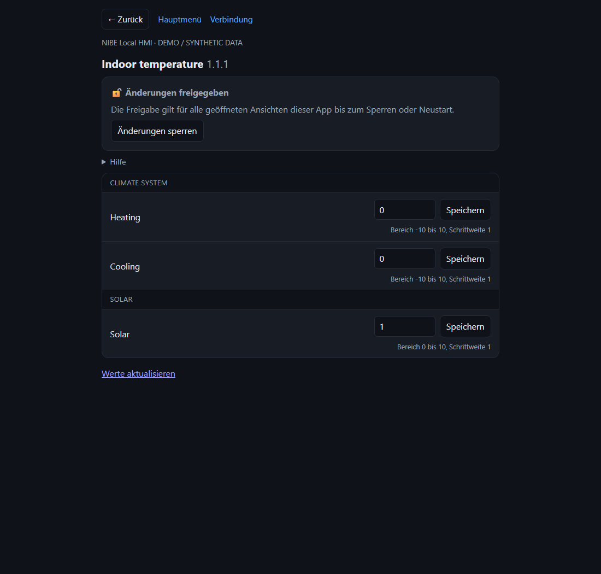

# NIBE Local HMI

A local menu interface for compatible NIBE controllers, running as a Home Assistant app.
Browse the controller's own menu tree, view values, and change supported settings directly
in their menu rows after explicitly unlocking writes.

**Experimental community project · first public release 0.5.0 · free non-commercial use of unmodified versions only; see LICENSE**

[](https://my.home-assistant.io/redirect/supervisor_add_addon_repository/?repository_url=https%3A%2F%2Fgithub.com%2FOniel10%2Fnibe-local-hmi)

[Deutsche Anleitung](docs/README.de.md) · [Setup and limitations](nibe_local/DOCS.md) · [Security model](SECURITY.md)

## Preview



The preview uses synthetic values; no customer installation is shown.

## Features

- Local mDNS discovery and pairing as **Home Assistant**; no token copying.
- Home Assistant Ingress, HA login, optional sidebar entry and admin-only access.
- Menu navigation with a one-level Back link, help text, units and selection labels.
- Inline numeric, selection, Boolean and supported text editors.
- Password fields masked by default, with an eye button that explicitly requests the value.
- Server-side write lock, enabled on startup and every restart; active risk acknowledgement required to unlock.
- Fresh controller metadata, bounds, step sizes and unchanged-value checks before writing.
- AES-256-GCM credential storage and automatic reconnect using the saved pairing.

## Install

1. In Home Assistant open **Settings → Apps → Install app → ⋮ → Repositories**.
2. Add `https://github.com/Oniel10/nibe-local-hmi`.
3. Install **NIBE Local HMI**, start it, and open its web interface.
4. Select the discovered controller, click **Koppeln**, and approve pairing at the controller if requested.
5. Open the menus. Writes remain locked until you actively acknowledge the warning.

If the badge opens the repository dialog without filling the URL, paste the URL manually.
Home Assistant builds the image on the device; internet access is needed during installation
and updates. Runtime controller communication is local and needs no cloud account.

## Compatibility and tested scope

Requires Home Assistant OS or another Supervisor installation supporting Apps and a controller
exposing the **myUplink PRO local token-pairing/menu API**. Firmware and model support are not
yet mapped. Installation and real read-only menu access were checked on one amd64 HA OS
installation. Exact model and firmware coverage still need community confirmation.

Both amd64 and aarch64 builds are configured; aarch64 hardware runtime has not been verified.
Mock tests cover writes and validation. Real heating settings and controller credentials have
not been changed as part of release verification. The UI currently uses German interface text;
menu labels come from the controller. HA option descriptions are supplied in English and German.

## Important boundaries

- This is an interactive menu app, not an MQTT entity bridge; it does not create HA sensor entities.
- HTTPS currently **does not verify the controller certificate**. Use only on a trusted LAN.
- Host networking is required for discovery. Ingress listens on host port **8099**, which must be free;
  only the Supervisor ingress gateway is accepted by the app.
- The encryption key is local for unattended restart. A full app-data or backup compromise can
  expose both the key and encrypted credentials.
- The UI lock controls writes through this app only. It does not change the controller's global
  REST read-only setting. Unlocking applies to all open views of this app until relock or restart.
- Time schedules, date/time screens, action buttons and special controller screens are not implemented.

[Full documentation](nibe_local/DOCS.md) · [Compatibility reporting](docs/COMPATIBILITY.md) · [Migration from a local install](docs/MIGRATION.md)

## Development

```sh
python -m pip install -r nibe_local/requirements.txt
python tests/test_app.py
python tests/test_ui.py
python tests/test_repository.py
node tests/test_eye.js
```

The GitHub Actions workflow runs offline controller mocks, package checks, the eye-button test,
and amd64/aarch64 container builds. It does not publish images or access a real controller.
See [contribution instructions](CONTRIBUTING.md) and the [release checklist](docs/RELEASING.md).

This project was developed with AI assistance. Maintainers are responsible for review,
verification, support and any claims made in a public release. No security audit is claimed.

Independent project; not affiliated with, endorsed by, or supported by NIBE or Home Assistant.
No vendor APK, decompiled source, certificate private keys or customer credentials are distributed.

License: free non-commercial use of unchanged versions; no sale or modified versions without written permission. This is source-available, not open source. Public GitHub viewing/forking rights and mandatory legal rights remain unaffected. See [LICENSE](LICENSE). The custom license has not been legally reviewed.
